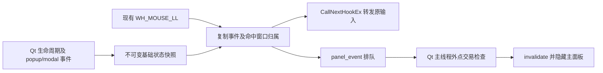

# 点击助手外部自动收起

设计开始：2026-10-12；最终收口：2026-10-13（Asia/Shanghai）。状态：**设计、源码实现与隔离自动验收完成：857 公共测试、356 显示回放、新增 40 项保护、6/6 交互错误注入通过。实际现场输入、便携 EXE 和原生 QA 恢复前台限制以[本轮开发记录](../development-records/2026-10-12-outside-click-collapse.md)为准。**

本设计依据[统一开发流程](../development-workflow.md)，与[当前架构](当前架构.md)的 Qt 主线程、被动鼠标通知和结果失效边界一致。用户希望展开助手后，点击游戏或屏幕其他位置即可收起，不必寻找右上角按钮。

## 1. 产品行为与验收目标

展开主面板后，一次真实鼠标左键点击的按下、抬起均位于助手交互窗口之外，且没有拖动，即收起为原有浮动标记。该点击继续按 Windows 原路径交给游戏、桌面或其他程序；助手只隐藏自己的面板，不切换前台，不合成第二次点击。

“空白处”按助手窗口之外解释，不判断游戏像素是否空白，也不检查那里是否有棋子、按钮或其他程序。这使返回游戏操作可以一步完成，且无需截图、OCR、游戏布局白名单或持续像素轮询。点击助手本身的空白区域仍可继续阅读和操作。

在“识别 / 设置”中加入“点击助手外部自动收起”，默认开启，使用现有 `input.ini` 的独立设置项持久保存。关闭后保留原有手动收起方式。该设置独立于“关闭鼠标侧键”，关闭侧键不会关闭外点收起。

| 场景 | 确定行为 |
| --- | --- |
| 面板展开，左键在游戏、桌面、任务栏或其他程序外部区域按下并抬起 | 收起；原点击传递给原目标；不请求切回 MuMu |
| 主面板内部，包括无控件的背景 | 保持展开 |
| 搜索、按钮、表格、攻略 WebEngine 等控件 | 按控件原行为处理，不收起 |
| 搜索建议、下拉列表、“更多”菜单、助手拥有的其他交互窗口 | 视为内部，不收起 |
| 助手 popup 打开时第一次外点 | 只按 Qt 原行为关闭 popup，不同时收起主面板；之后一次完整外点才收起 |
| 文件选择等模态对话框打开期间 | 暂停外点收起，不隐藏对话框所属面板 |
| 按下在面板/标记内，抬起在外；按下在外，抬起在内 | 不收起 |
| 拖动主面板、标记、文本、滚动条、尺寸手柄，结束位置在外 | 不额外收起 |
| 外部拖动离开按下点后又回到原点 | 不按普通点击处理 |
| 右键、中键、滚轮、侧键、普通鼠标移动 | 不触发本功能 |
| Alt+Tab、失焦、其他程序自行抢前台、网络回调 | 不触发本功能 |
| 点击标记展开；展开前已有左键按下 | 不将同次抬起当作外点，不立即再收起 |
| Ctrl+Alt+F9、原收起按钮、点击展开标记、退出 | 保留原有语义，退出仍结束程序 |
| 面板已收起、最小化、功能关闭或正在退出 | 不进行额外点位命中测试，不保留待收起交易 |
| 原生监听启动失败或命中归属无法确定 | 不误收起；保留按钮、标记与已注册快捷键，明确功能不可用 |

收起不清除本局已选资源、固定阵容、检索文字和条件、排序、样本门槛、攻略页面与滚动位置，不创建新局，不重新查询阵容或重新加载攻略。临时候选、过期排名及其异步结果按现有 `invalidate()` 语义撤下；自动识别是否继续仍取决于既有开关、绑定和当前游戏前台门槛。

## 2. 当前源码依据

| 当前入口 | 已有事实及本轮衔接 |
| --- | --- |
| [mouse_shortcut.py](../../outputs/companion/mouse_shortcut.py) `MouseShortcut.dispatch()` | 已使用同一 `WH_MOUSE_LL`，发出真实左键 down/up 和一次超过 8 原生坐标单位的拖动通知；注入事件不进入通知，`finally` 始终调用 `CallNextHookEx` |
| [app.py](../../outputs/companion/app.py) `main()` | 已将鼠标侧键、左键选择通知以 `Qt.QueuedConnection` 交给主线程；退出清理停止同一 hook |
| [app.py](../../outputs/companion/app.py) `return_to_game()` | 目前主动调用 `SetForegroundWindow`，被拒时暂停自动识别并显示面板；不适合用于点击其他程序后的被动收起 |
| [app.py](../../outputs/companion/app.py) `invalidate()`、`showEvent()`、`hideEvent()` | 已有临时候选/排名失效及标记同步；本功能复用这些语义，不复制一套候选生命周期 |
| [app.py](../../outputs/companion/app.py) `drag_window()` | 主面板使用原生 `startSystemMove()`；需要用完整按下/抬起和拖动记录排除外部抬起 |
| [floating_mark.py](../../outputs/companion/floating_mark.py) | 标记不获取焦点，点击切换面板，拖动后不触发点击；不是覆盖整屏的事件层 |
| [comp_browser.py](../../outputs/companion/comp_browser.py)、[condition_inputs.py](../../outputs/companion/condition_inputs.py) | 实际存在 `QCompleter` 搜索 popup 和 `QMenu`；不能只用主面板矩形排除内部点击 |
| [app.py](../../outputs/companion/app.py) `open_image()` | 实际存在原生文件选择对话框，须有模态阻塞边界 |
| [win_capture.py](../../outputs/mumu-p0-probe/win_capture.py) | 已在创建 Qt 窗口前请求 Per Monitor V2，并绑定 `WindowFromPoint`、`GetAncestor`、`GetWindowThreadProcessId`；现有 `describe()` 限制 MuMu 身份，不能用它判断所有桌面窗口 |

以上说明现有实现；下一节描述本轮采用的新增合同。历史记录中的通过数字不作为本轮受测证据。

## 3. 模块、事件合同与实现步骤

新增 `outputs/companion/panel_dismissal.py` 小型控制器，拥有外点交易、展开 epoch 和 popup/modal 保护。`Companion` 仍拥有主面板、持久设置和实际收起动作；`MouseShortcut` 仍拥有原生监听。保持原有选择事务的 `left_event` 合同，新增独立不可变 `panel_event` 快照，不给本局自动选择增加新的确认依据。

### 3.1 只读取基础状态的原生监听

Qt 主线程通过控制器维护功能开关、面板展开/退出状态和 popup/modal 阻塞状态，只向 hook 同步 `tracking` / `blocked` 两个普通布尔值。控制器使用高精度 `time.perf_counter()` 的时间屏障保护本轮展开，等价于展开 epoch；事件无需携带额外代次字段。窗口 Show/Hide、最小化恢复、功能设置改变、popup/modal 显隐和 shutdown 都同步状态并取消旧交易。应用事件过滤器只观察相关窗口事件，始终保留原有 Qt 事件处理，不通过返回 `True` 吞掉鼠标操作。

原生 hook 读取已准备好的基础快照，不访问 Qt 控件、调用 `processEvents()`、遍历 widget、运行截图、OCR、网络或文件写入。主面板关闭、最小化、开关关闭、正在退出时，跳过本功能新增的原生命中测试；已有侧键/选择通知继续按原合同工作。

仅在需要本功能的真实左键通知中，将 `MSLLHOOKSTRUCT.pt`、动作、`perf_counter()` 时间、窗口归属与阻塞状态复制为 `PanelMouseNotice(action,x,y,at,inside,blocked)`。使用 `WindowFromPoint` 获得点位窗口，`GetAncestor(..., GA_ROOTOWNER)` 归一化父窗口/拥有者链，再通过 `GetWindowThreadProcessId` 判断窗口是否属于助手进程；保存查询时的结果。子控件、助手拥有的 popup/native dialog、标记都属于助手交互范围。无法获得可信窗口/归属时保守拒绝此次收起。

所属窗口查询发生在通知生成时，而非 Qt 队列消费时：下拉菜单可能在两者之间关闭，主面板也可能移动。不得用较晚的窗口状态改写这次点击最初的归属。`GetForegroundWindow()` 不是点击目标证据；事件生成时前台切换可能尚未完成，故不要求其已经等于绑定游戏。

每次按下最多发出一次超过拖动距离的 move 通知，保持现有有界机制。已有 `CallNextHookEx` 的 `finally` 继续包住新增通知；控制器或通知接收方异常也不能阻断输入传播。

### 3.2 Qt 主线程交易规则

控制器只接受 hook 过滤后的真实左键、类型正确、时间有限、晚于当前展开时间屏障的事件；单条通知被消费时，要求 `0 <= now - event.at <= 0.75` 秒。0.75 秒是队列通知的最大寿命，不是用户按住左键的额外产品倒计时；过期/非法通知清除完整待点击状态，下一次新点击即可继续。新链路生产者与消费者均使用 `perf_counter()`；旧选择通知保留原 `monotonic()`，不能混用两种时钟基准。本机 Python 3.12 的普通 `monotonic()` 分辨率为 15.625 ms，快速 down/up 可能同时间戳，故不用于新链路严格时序。

1. 展开时重建时间屏障并清空待处理按下。时间不晚于本次屏障的通知、缺少本次展开后有效 down 的 up 均拒绝，因此点击标记展开不会立即收起。
2. down 时只有快照未被 popup/modal 阻塞、归属明确为外部，才登记待处理外点。内部按下不登记，外部按下后内部抬起也不收起。
3. hook 只在位移平方超过 `8 * 8` 时发出一次 move excursion，控制器收到 move 就永久取消本次点击，即使最后回到按下点也不恢复。up 另检查距 down 的位移平方不超过 `8 * 8`；阈值与现有 hook 相同，不混用浮动标记的 Qt 逻辑坐标阈值。
4. up 时再次检查当前展开/设置/epoch、本次通知时效、抬起归属，以及配对 down 的保护状态；全部有效才请求收起一次。清空交易后再执行收起，重复 up 不会二次执行。
5. popup 显示期间生成的 down 必须带阻塞快照，不能因为 up 到达时 popup 已消失而追认这次外点。模态对话框同样阻塞；对话框关闭前生成的旧事件不在关闭后补执行。
6. 关闭/最小化/退出、设置改变和阻塞状态改变取消交易。hook 卸载之前先停用控制器，排队的旧事件随后也无操作。

popup/modal 状态由 Qt 生命周期和应用事件过滤器维护；每个窗口仅建立一次 `destroyed` 订阅，直接销毁同样释放阻塞。原生文件选择使用 `suspended()` 的显式、可嵌套作用域保护，在进入对话框前阻塞，返回或异常退出后释放。不能只在 queued slot 读取 `activePopupWidget()` 或 `activeModalWidget()`，否则第一次外点已经关闭 popup 时会误收起。hook 读取的状态始终是普通值，不把 QWidget 引用带入原生回调。

### 3.3 被动收起与设置

`Companion.collapse_passively()` 确认主面板仍展开后调用现有 `invalidate()` 并隐藏主面板。在线普通实例保留浮动标记；离线交互测试显式展示测试标记。不调用 `return_to_game()`、`SetForegroundWindow` 或自动识别开关，不把被拒焦点切换显示为这次操作错误。

原收起按钮和 Ctrl+Alt+F9 继续调用原有主动返回游戏路径。新设置保存到现有 `QSettings`，读取缺省值为开启；开关变化立即取消待处理点击。监听失败时仅禁用本功能能力并给清晰状态，不能伪称启用成功或新建轮询/全屏透明窗口补偿。

## 4. 多显示器、DPI 与生命周期

点位始终使用 `MSLLHOOKSTRUCT` 的有符号屏幕坐标；左侧/上方显示器的负值合法。命中与窗口归属都走原生 API，避免将原生屏幕坐标直接与 Qt 逻辑 `geometry()` 比较，也不按主屏幕比例换算另一个显示器。

面板跨屏、缩放、移动后，下一个事件按实际点位命中，不沿用旧主屏矩形。按下时和抬起时分别保存归属；即使窗口在中途移动到鼠标下方，抬起被判为内部也不会误收起。拖动阈值为 8 原生坐标单位，是此次明确采用的工程容差；不同 DPI 下的真实鼠标体感需现场核对，不能由模拟负坐标测试声称完成混合 DPI 硬件验收。

沿用同一个 hook 的启动/退出，不新增后台线程、定时轮询或事件捕获窗口。controller 停用、hook 卸载、快捷键注销、`panel.shutdown()` 都在已有统一清理边界完成；移除应用事件过滤器，清除 popup/modal 跟踪和待处理交易。普通单实例及 WebEngine 辅助进程不改变；攻略点击最终需在实际 Qt 链路证明被归为内部，不单凭“进程名相似”认领窗口。

## 5. 测试矩阵与独立证据

本次是新交互需求，不把缺少该功能写成已有原始崩溃或识别失败。先建立行为测试，再实现；测试预期来自第 1 节合同、官方输入 API 和独立外部接收窗口，不从当前实现生成。

| 层级 | 必须覆盖 | 证据与边界 |
| --- | --- | --- |
| 点击交易 | 外部 down/up；内部；跨内外；missing/重复 up；注入事件；超龄/未来时间；epoch 切换；退出 | 精确事件序列及收起次数；不能用测试名称代替断言 |
| 拖动 | 超过 8；阈值内；超出后返回；主面板/标记/尺寸拖动后外部抬起 | 同次按下最多一次 excursion；超过后不恢复为点击 |
| 原生 hook 合同 | 同一 hook；真实事件复制；负坐标；root-owner/PID 归属；未知归属；接收异常 | 所有分支仍 `CallNextHookEx`；收起动作只在 queued slot 运行；关闭时不增加 hit-test |
| 实际 Qt 控件 | 面板空白、搜索、建议、下拉列表、更多菜单、攻略、标记 | 实际控件交互不被自动收起，保留控件原操作 |
| popup/modal | 首次外点关闭 popup 后的 up；按下后 popup 出现；模态文件选择；返回后旧队列通知 | 不将“消费时 popup 已消失”追认为允许收起 |
| 展开/关闭 | 标记打开同次 up；快捷键展开；设置关闭；最小化/恢复；shutdown 后旧事件 | 不展开即收起，不在关闭后访问已删除控件 |
| 状态保留 | 文字、条件、固定阵容、已选资源、排序、样本门槛、攻略 URL 与滚动位置 | 实际 Companion/Qt/WebEngine 状态前后比较；无额外检索或页面 reload |
| 前台及输入 | 外部独立普通原生窗口收到原点击；仍是其前台；原按钮保留主动返回语义 | 记录原生窗口句柄/点击计数；故障实现抢焦点或吞输入应被拒绝 |
| 临时显示与异步 | 自动收起撤下候选/旧排名；迟到回调不重新展开或出版旧浮层 | 真实 Qt 生命周期及队列操作；不改数据 oracle |
| 配置与失败 | 默认开启、开关立即生效、下次实例保存；关闭侧键不影响本功能；hook 不可用 | 使用隔离临时设置目录，不能修改正在使用的用户配置 |
| 多屏/DPI | 模拟负屏幕点位及 native ownership；真实多屏/不同缩放另做实测 | 模拟证明坐标合同，实物结论必须有具体显示器/DPI 记录 |

沿用 `test_mouse_shortcut.py`、`test_compact_header.py` 和 `test_comp_browser.py` 的已有保护，新增控制器和整合链路测试。精确方法 ID 在实现后登记到历史注册表的收起/输入边界相关项，保留所有旧 ID 和 fixture。新保护纳入现有 `tools/validate_data.py` 自动发现和报告，不另留只手动执行的隐藏套件。

必须做相关受控错误注入，例如移除内部点击保护、接纳旧 epoch、把外点转成主动返回游戏或跳过输入转发；新测试应拒绝这些错误。源码/Qt 合同执行通过不等于真正物理鼠标 hook、真实 MuMu 全屏合成、游戏 FPS、其他 Windows/杀软/驱动或便携 EXE 已通过。

按[统一开发流程](../development-workflow.md)固定开工 SHA、解释器和本轮 diff 后，先执行受影响套件，再执行 Python 3.12 公共统一入口。涉及候选显示/数据回调边界时执行现有数据故障注入，确保该变更没有削弱既有排名保护。没有改识别/捕获/原帧路径时，私有原图回放不是本功能现场鼠标证据；按实际触及范围选择复验并如实记录。

代码改变后保留真实 Qt 界面截图和本机原生窗口检查结果，原始日志/图像保存 `work/<本轮唯一名称>/`，适合公开的摘要进入本轮开发记录。截图不包含游戏或玩家信息时可作为公开布局证据；涉及私人原图继续按既有批准索引与本机边界处理。

## 6. 官方依据与工程判断

查阅日期：2026-10-12。Windows 部分采用 Microsoft Learn；Qt 部分采用与当前 PySide6 6.8.3 同主版本的 Qt 6.8 API 文档。文档站当前维护补丁版本不代表本仓依赖升级。

| 官方资料 | 直接支持的事实 | 本设计据此作出的工程选择 |
| --- | --- | --- |
| [LowLevelMouseProc](https://learn.microsoft.com/en-us/windows/win32/winmsg/lowlevelmouseproc) | 原生输入将被加入目标线程队列前调用 hook；应及时返回；超时可能静默移除 hook；调用 `CallNextHookEx` 保持传播 | 复用现有 hook，保持有界查询和通知；不做 GUI/截图/网络工作，不依据当时前台窗口猜点击目标 |
| [MSLLHOOKSTRUCT](https://learn.microsoft.com/en-us/windows/win32/api/winuser/ns-winuser-msllhookstruct) | 点位为 per-monitor-aware 屏幕坐标，结构包含注入标志 | 使用原生坐标/点位命中，排除注入输入，复制不可变快照 |
| [WindowFromPoint](https://learn.microsoft.com/en-us/windows/win32/api/winuser/nf-winuser-windowfrompoint) | 返回指定点位窗口；隐藏、禁用窗口不返回 | 事件发生时保存窗口归属，模态期间单独阻塞，未知命中不收起 |
| [GetAncestor](https://learn.microsoft.com/en-us/windows/win32/api/winuser/nf-winuser-getancestor) | `GA_ROOT` 只沿父窗口链；`GA_ROOTOWNER` 还沿拥有者链 | popup/owned window 以 root-owner 归一化，不只比较主面板矩形 |
| [GetWindowThreadProcessId](https://learn.microsoft.com/en-us/windows/win32/api/winuser/nf-winuser-getwindowthreadprocessid) | 可获取创建窗口的线程及进程 ID | 使用助手 PID 判断拥有关系，不按标题包含“助手”或 MuMu 猜归属 |
| [Qt 6.8 QApplication](https://doc.qt.io/qt-6.8/qapplication.html#activePopupWidget) | 提供 popup/modal 等当前应用窗口状态 | 在 Qt 线程维护保护状态及不可变快照；不能只在迟到 slot 才检查当前 popup |
| [Qt 6.8 QObject 事件过滤器](https://doc.qt.io/qt-6.8/qobject.html#installEventFilter) | 可在对象处理前观察事件，过滤器返回值决定事件是否继续 | 观察生命周期同步状态，保持原有 Qt 处理和原生输入传递 |

上述 API 事实不自动保证某台 MuMu/Windows 硬件运行正确。8 原生坐标单位、0.75 秒通知寿命、popup 首次外点保护和默认开启是本轮确定的产品/工程选择，需通过第 5 节的独立验证。

## 7. 本轮完成条件与交付范围

本功能完成需设计与实际接口同步、受影响测试及统一报告没有未解释失败/跳过、错误注入拒绝相关缺陷、配置和生命周期通过实际 Qt 检查、原始证据与本轮开发记录齐全。实现中采用不同字段/方法名时同步本文的合同，不改变以上用户行为和保护边界。

当前本文仅固定设计；功能状态、受测提交/diff、实际运行命令和结果、审阅发现、未覆盖硬件项、提交/CI 信息由本轮开发记录填写。未要求发布时不创建新版本或把源码验证称为 EXE 验收；若之后要求发布，按统一流程从通过 CI 的固定源码提交构建并独立验证真正便携 EXE。
